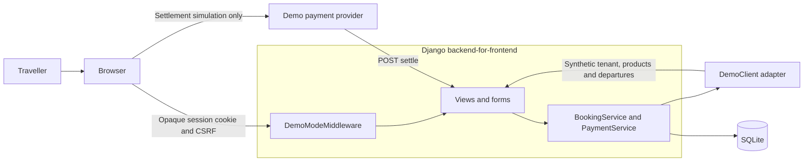
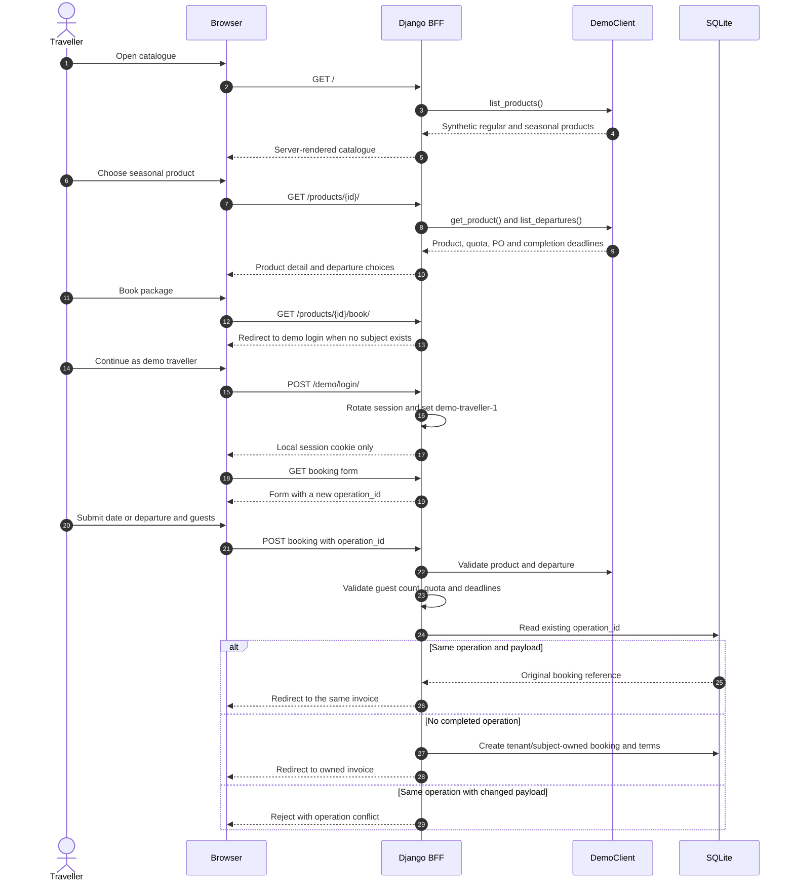
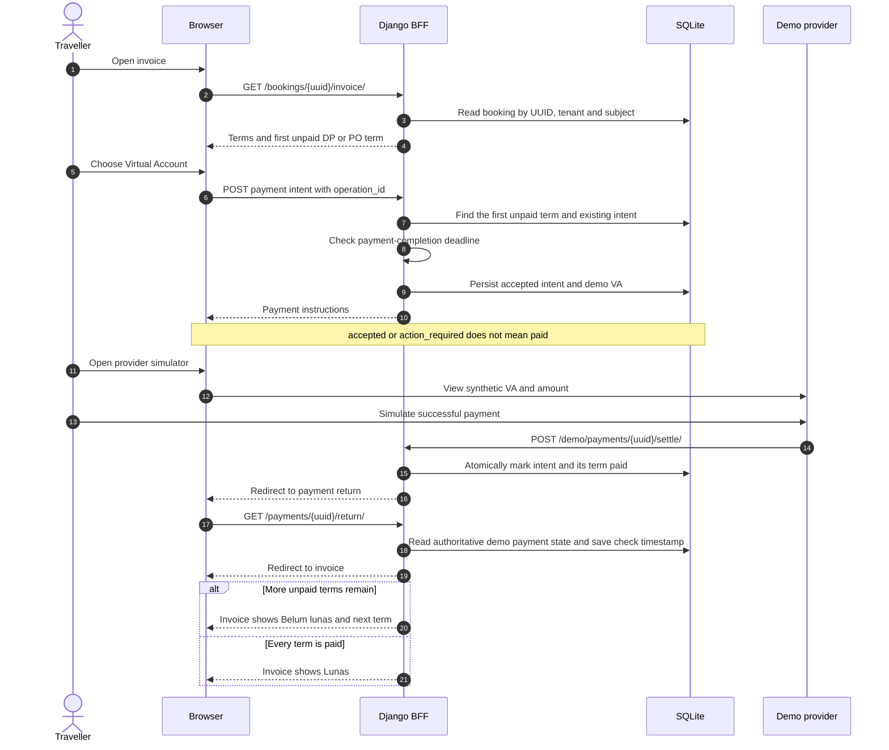
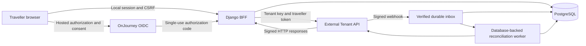
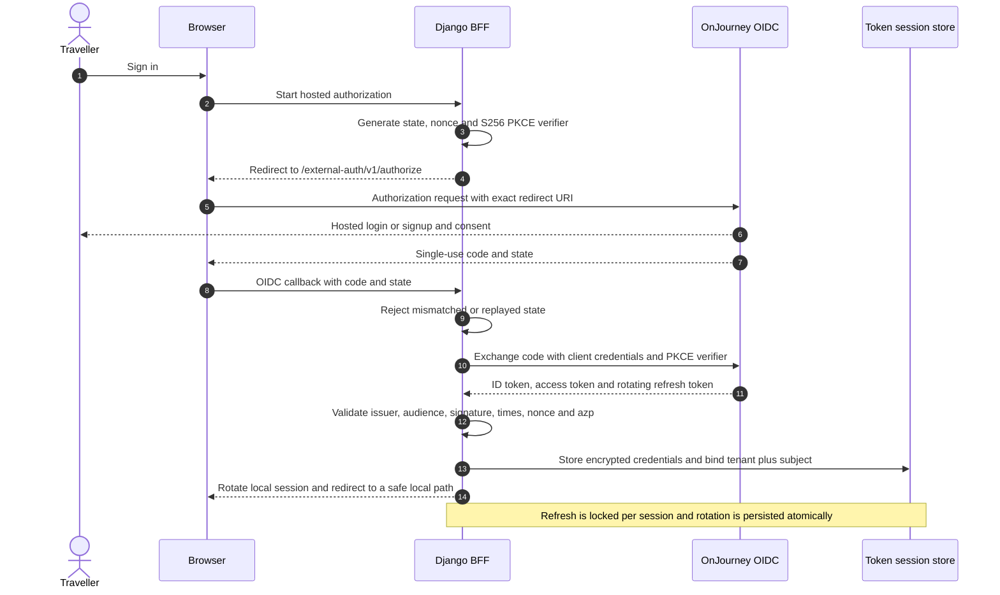
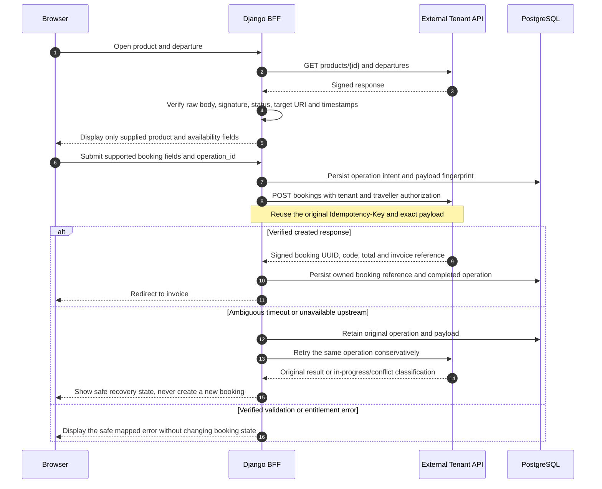
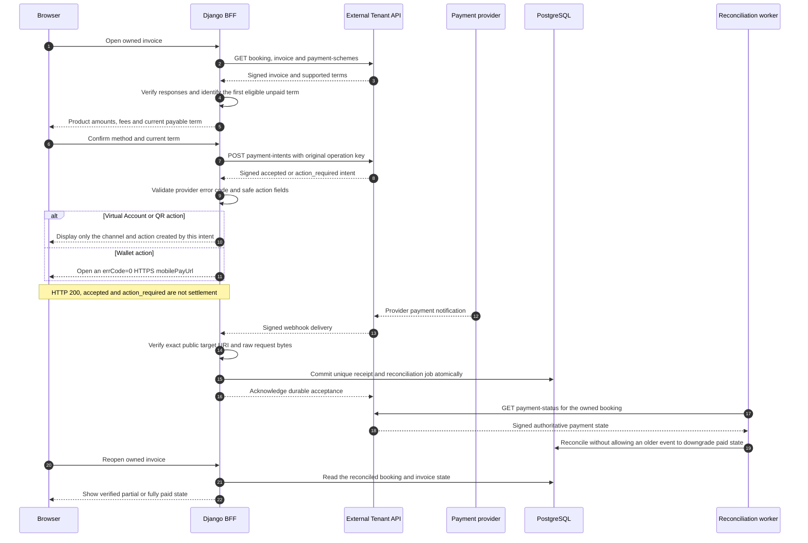
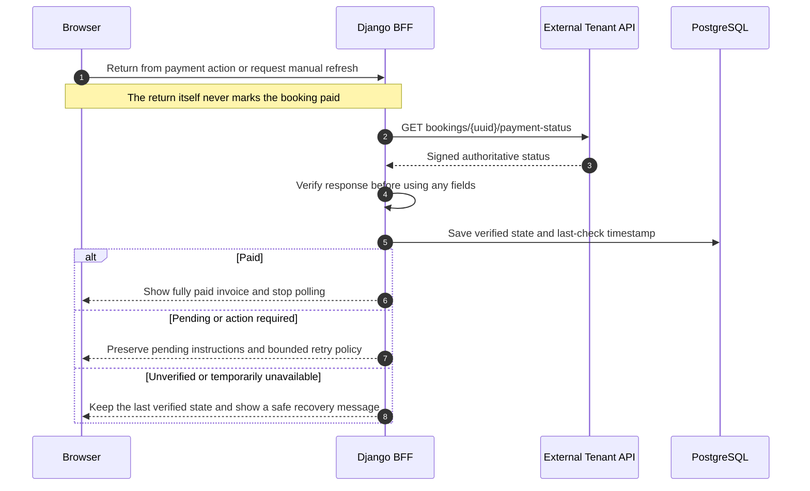

# Integration flow architecture

This document describes the integration architecture of the OnJourney Mitra Django example. It distinguishes the **implemented credential-free POC** from the **target live integration**. Target diagrams are design guidance, not claims of deployed compatibility.

## 1. Scope and authority

The application is a backend-for-frontend (BFF) for one Mitra-owned traveller storefront. OnJourney is intended to remain the authority for traveller identity, catalogue, availability, bookings, invoices, and payment state. Local records support browser sessions, ownership, idempotency, and reconciliation; they are not a second booking engine.

The current repository implements the following flow entirely with synthetic data:

```text
Catalogue → simulated sign-in → booking → invoice → payment intent
          → simulated provider settlement → status recovery → partial or fully paid invoice
```

Not implemented: live HTTP transport, hosted OIDC, encrypted traveller tokens, response-signature verification, webhooks/SSE, PostgreSQL concurrency, real payment discovery, or real charges. See `api-coverage.md` for the capability matrix.

## 2. Implemented POC architecture



### Component responsibilities

| Component | Responsibility | Main files |
| --- | --- | --- |
| Browser | Renders server-generated HTML and holds only the local session cookie. Never receives tenant credentials or traveller tokens. | `templates/`, `static/` |
| Demo mode middleware | Closes the storefront when demo mode is disabled and applies private/no-store headers to demo, booking, and payment paths. | `storefront/middleware.py` |
| Views and forms | Validate input, safe return URLs, CSRF-protected writes, and ownership checks. | `storefront/views.py`, `storefront/forms.py` |
| Application services | Own booking/payment rules, Decimal arithmetic, sequential terms, idempotency, deadlines, settlement, and status reads. | `storefront/services.py` |
| Demo adapter | Supplies synthetic tenant, product, and relative-date departure contracts without upstream calls. | `integrations/onjourney/adapters/demo.py` |
| Local models | Bind booking references to tenant and demo subject, retain operation IDs and payload hashes, and persist intents and payment terms. | `storefront/models.py` |
| Demo provider | Simulates provider settlement. It never handles money and is unavailable when demo mode is disabled. | `storefront/views.py`, `templates/storefront/demo_payment_provider.html` |

### Local data boundaries

- `BookingReference.subject` and `tenant_slug` scope every booking read. A UUID alone does not grant access.
- `operation_id` and `payload_hash` make booking creation replay-safe. Reusing an operation with a changed payload raises a conflict.
- A payment intent has a unique operation ID and a unique booking/installment pair. Repeated submissions cannot create a second intent for the same term.
- Booking terms store decimal-string amounts and paid flags. Product-paid, remaining-product, and fee-paid amounts remain separate.
- Authenticated pages use private/no-store cache headers. Production mode closes all demo routes except `/health/`.

## 3. Current demo sequence

### 3.1 Catalogue, simulated identity, and booking



The local history page lists only bookings created by the current demo subject on this installation. It is not a complete OnJourney history.

### 3.2 Intent, simulated settlement, and return



A direct or forged browser return cannot mark an intent paid. Only the provider-simulation route changes settlement state. Revisiting a paid intent redirects to its invoice instead of displaying stale pending instructions.

## 4. Target live architecture

The following components are required before enabling a live adapter. They do not exist in the current POC.



### Required security boundaries

| Secret or authority | Allowed location | Browser exposure |
| --- | --- | --- |
| Tenant API key | Backend secret manager, scoped to the installation | Never |
| OIDC client secret | Backend secret manager | Never |
| Traveller access/refresh token | Encrypted server-side token session with refresh locking | Never |
| External API response-signing keys | Backend trust store with approved initial pins | Public keys only, never private keys |
| Raw event-stream ticket | Server-held, one-use, short-lived connection state | Never |
| Local browser session | Opaque, rotated, HttpOnly, Secure, SameSite=Lax cookie in deployment | Session cookie only |
| Payment status | Signed API response or verified webhook followed by reconciliation | Derived display state only |

The OIDC signing keys and External API response-signing keys are separate trust domains. Production startup must fail for missing encryption keys, trust pins, or unsafe origins. Demo settings and synthetic identity must remain disabled.

## 5. Target hosted authentication sequence



Logout must revoke supported upstream credentials without relying on upstream availability to clear the local session. `invalid_grant` during refresh expires the local session safely; concurrent refresh requests must not lose the rotated token.

## 6. Target catalogue and booking sequence



Only contract-supported booking fields may be sent. Quota, PO eligibility, guest requirements, and deadlines must be revalidated upstream at write time. Local validation improves UX but is not the authority.

## 7. Target payment and reconciliation sequence



Payment-option discovery and scheme-confirmation semantics remain contract gates. The POC's configured VA option must not be presented as proof that general live discovery works.

## 8. Browser return and manual recovery



A production reconciliation policy should combine webhooks with manual refresh and a capped schedule for known pending bookings. It must honor `Retry-After`, stop after settlement or configured expiry, and account for request-credit usage.

## 9. State and amount rules

| Concept | Meaning |
| --- | --- |
| `accepted` | The upstream intent was accepted without a required browser action. It is not proof of payment. |
| `action_required` | The traveller must complete a validated payment action. It is not proof of payment. |
| DP/PO paid | The first partial-payment term is settled. The invoice remains unpaid until all required terms are settled. |
| Fully paid | The authoritative invoice says all required payment is complete. An older event must not downgrade this state. |
| Product price | Booking `total_price`, not an invoice total that may include fees. |
| Current payment | Current term plus the applicable VAT-inclusive transaction fee exactly once. |
| Product reconciliation | Product-paid plus remaining-product equals product price when the API supplies an unambiguous breakdown. |

All money calculations use `Decimal` and preserve decimal-string API values. Unknown or ambiguous fee projections must be labelled as limitations rather than reconstructed in the UI.

## 10. Failure handling checklist

- Disable implicit upstream redirects and enforce configured HTTPS origins, timeouts, response-size limits, and redacted logs.
- Verify every signed response before parsing or trusting its fields; unsigned proxy errors cannot update transaction state.
- Retry reads conservatively. Retry writes only with the persisted identical operation, key, and payload.
- Treat authentication, scope, credits, not-found, validation, idempotency, rate-limit, provider, verification, and availability failures as separate safe categories.
- Deduplicate webhook delivery IDs and event IDs with durable retention; acknowledge only after persistence succeeds.
- Never let challenge handling, SSE frames, browser returns, or stale events directly prove or downgrade settlement.
- Keep one tenant per installation and enforce tenant plus subject ownership locally and upstream.

## 11. Verification map

| Behavior | Automated coverage |
| --- | --- |
| Regular and seasonal booking, quota, deadlines and ownership | `tests/test_demo_booking.py`, `tests/test_storefront_web.py` |
| Idempotent booking/payment creation and sequential DP/PO | `tests/test_demo_payment.py`, `tests/test_payment_web.py` |
| Partial and fully paid journeys, forged browser returns | `tests/test_payment_web.py` |
| Paid-intent revisit, completion cutoff and relative demo dates | `tests/test_review_regressions.py` |
| Production demo guard and private/no-store responses | `tests/test_release_security.py` |
| Deployment warnings and local-only unprivileged container | `tests/test_release_security.py` |

Run the current verification suite with:

```bash
uv run pytest -q
uv run ruff check .
uv run python manage.py check
```

Passing demo tests do not prove deployed External API compatibility. A live release still needs contract pinning, signed-transport tests, OIDC/security review, PostgreSQL concurrency tests, and validation against an approved test tenant.
